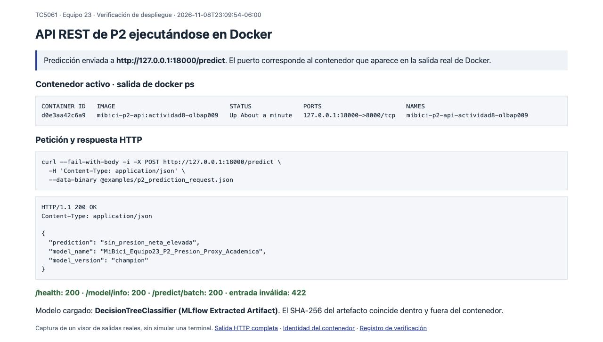
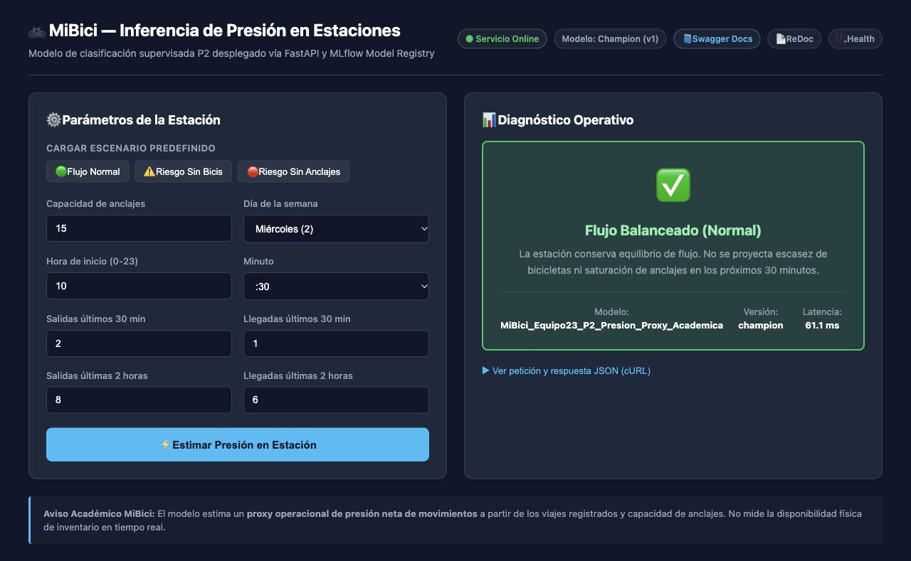

# API REST de P2: despliegue y consumo

## Propósito y estrategia

El servicio de MiBici estima la clase de presión neta de movimientos de una
estación para el siguiente intervalo de 30 minutos. Se utiliza **inferencia en
línea**: el consumidor envía las variables disponibles al comenzar un intervalo y
recibe una predicción HTTP/JSON sin esperar un proceso por lotes. Este modo permite
consultas individuales; `/predict/batch` permite agrupar varias entradas en una
petición. No se afirma una latencia garantizada.

La etiqueta es un indicador proxy de los flujos de viajes respecto a la capacidad;
no mide directamente bicicletas o anclajes disponibles físicamente.

## Modelo empaquetado y Registry

La imagen incluye el artefacto de MLflow de `models/p2_champion/` y configura
`MODEL_PATH=/app/models/p2_champion`. El [manifiesto](../models/p2_champion/manifest.json)
conserva la procedencia declarada del paquete:

| Dato | Valor |
| --- | --- |
| Registry | `https://dagshub.com/bryan-s-ortega/TC5061-Proyecto-Equipo23.mlflow` |
| Nombre | `MiBici_Equipo23_P2_Presion_Proxy_Academica` |
| Alias | `champion` |
| Versión del paquete | `1` |
| Corrida de origen | `55225195968642979a681bf751d9e2f8` |

La ruta de despliegue elegida es **empaquetar en la imagen el modelo que el equipo
extrajo del Registry**. En esta configuración la inferencia no necesita conectarse
a un servidor MLflow externo al arrancar. Los metadatos anteriores identifican el
paquete publicado; no equivalen a una nueva auditoría de su entrenamiento ni a una
comprobación independiente de todas las corridas de selección anteriores.

La aplicación también admite carga por URI con `MLFLOW_TRACKING_URI` y `MODEL_URI`,
pero prioriza los artefactos locales existentes. Cambiar solo la URI no sustituye
un paquete local que se carga correctamente. La prueba de esta entrega utiliza el
paquete incluido en la imagen y no modifica el Registry ni el alias remoto.

## Requisitos y construcción de la imagen

Se requiere Docker con su motor iniciado, Git y acceso de red para descargar las
imágenes base y dependencias. Ejecutar los comandos desde la raíz del repositorio.
El archivo [Containerfile](../Containerfile) utiliza Python 3.13 y las versiones
resueltas en `uv.lock`; `requirements-api.txt` dejó de utilizarse.

```bash
docker build --progress=plain -f Containerfile \
  -t mibici-p2-api:actividad8-olbap009 .
```

Se copian `README.md` y `LICENSE` porque son metadatos requeridos por Flit al
instalar el paquete definido en `pyproject.toml`.

## Inicio y comprobación del servicio

```bash
docker run -d --rm --name mibici-p2-api-actividad8-olbap009 \
  -p 127.0.0.1:18000:8000 \
  mibici-p2-api:actividad8-olbap009

docker ps --filter name=mibici-p2-api-actividad8-olbap009
curl --fail-with-body http://127.0.0.1:18000/health
curl --fail-with-body http://127.0.0.1:18000/model/info
```

El puerto 8000 del contenedor se publica en el puerto **18000** de la máquina
local. La interfaz web está en `http://127.0.0.1:18000/ui` y Swagger en
`http://127.0.0.1:18000/docs`. El puerto alternativo evita depender de que el 8000
esté libre en el anfitrión.

Antes de interpretar una predicción, revisar `/model/info`: un `model_type` que
incluya `In-Memory Fallback` indica el modelo sintético de demostración, no el
artefacto empaquetado. Un HTTP 200 o un estado `healthy` por sí solos no distinguen
ambos casos. En esta prueba se comprobó además que el hash del archivo cargado
en el contenedor coincide con el paquete del repositorio.

## Petición de prueba

El contrato original está en [schemas.py](../mibici/api/schemas.py) y se describe
en [p2_api_contract.md](../references/p2_api_contract.md). Se usa el mismo JSON
compartido por el equipo, disponible en
[examples/p2_prediction_request.json](../examples/p2_prediction_request.json):

```json
{
  "departures_prev_30m": 2,
  "arrivals_prev_30m": 1,
  "departures_prev_2h": 8,
  "arrivals_prev_2h": 6,
  "hour": 10,
  "minute": 30,
  "day_of_week": 2,
  "capacity": 15
}
```

Los conteos deben ser enteros no negativos; `hour` va de 0 a 23, `minute` admite
0 o 30, `day_of_week` va de 0 a 6 y `capacity` debe ser positiva. No se admiten
campos adicionales ni faltantes.

```bash
curl --fail-with-body -i \
  -X POST http://127.0.0.1:18000/predict \
  -H 'Content-Type: application/json' \
  --data-binary @examples/p2_prediction_request.json
```

Respuesta real obtenida desde el contenedor el 8 de noviembre de 2026, con HTTP
200:

```json
{
  "prediction": "sin_presion_neta_elevada",
  "model_name": "MiBici_Equipo23_P2_Presion_Proxy_Academica",
  "model_version": "champion"
}
```

La [salida HTTP completa](../reports/evidence/api/curl_predict.txt) conserva los
encabezados y el cuerpo devueltos por Uvicorn.


`model_version` devuelve actualmente el alias `champion`; la versión numérica `1`
procede del manifiesto del paquete. No se presenta el alias como si fuera un
identificador inmutable de versión.

## Evidencia y alcance de la verificación

Los comandos, resultados JSON, imagen, contenedor, versiones y hashes se conservan
en [reports/evidence/api](../reports/evidence/api/). Se verificaron
una petición válida (HTTP 200), una petición con capacidad cero (HTTP 422), salud,
metadatos, predicción por lote e interfaz web (HTTP 200). También se ejecutaron
las pruebas de contrato y endpoints en un segundo contenedor temporal: **28
aprobadas, una advertencia**, con PyTest 9.2.0. No se repitió toda la suite de
54 pruebas reportada por Bryan.





La primera captura es un visor de las salidas reales de `docker ps` y `curl`,
conservadas en archivos de texto; no simula una terminal. La segunda corresponde
a la interfaz de la API servida por el contenedor en el puerto 18000.

Para detener el contenedor al finalizar:

```bash
docker stop mibici-p2-api-actividad8-olbap009
```

## Contribución

Miguel aportó el contrato y sus pruebas; Kevin el contenedor inicial; Bryan la
API, el modelo empaquetado y la integración con `uv.lock`. Juan Pablo Islas Guzmán
(A01797727 / `Olbap009`) preparó esta documentación y el ejemplo compartido, y
completó la verificación y la evidencia de despliegue con apoyo de Codex. También
se corrige la copia de metadatos del paquete en la imagen y se conservan archivos
de las entregas anteriores, como exige la consigna.
